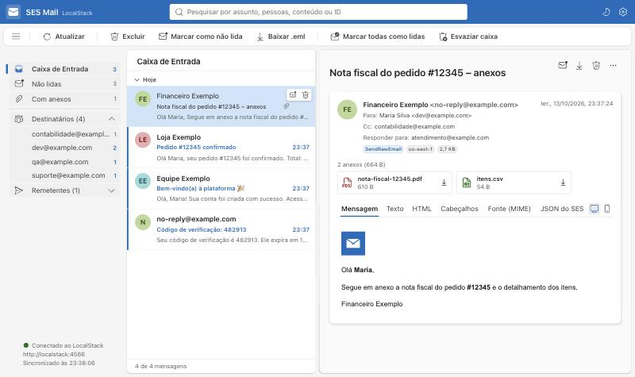
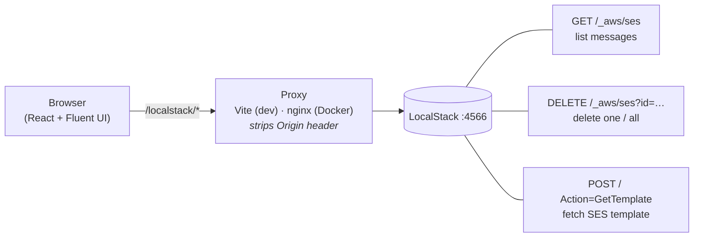

<div align="center">


# SES Mail Viewer

**An Outlook‑style inbox for the emails your app sends to Amazon SES on [LocalStack](https://localstack.cloud).**

See every message exactly as your users would: rendered HTML, attachments, inline images, templates and raw MIME. No real email ever leaves your machine.

[](https://github.com/renatoasterio/ses-mail-viewer/actions/workflows/ci.yml)
[](LICENSE)


[](CONTRIBUTING.md)

[Quick start](#-quick-start) · [Features](#-features) · [Configuration](#%EF%B8%8F-configuration) · [How it works](#-how-it-works) · [Docs](docs/) · [Português](README.pt-BR.md)

<br />



</div>

---

## ✨ Why

LocalStack emulates Amazon SES but never delivers email. It stores every message and exposes them as JSON on an internal endpoint (`GET /_aws/ses`), complete with raw MIME and base64 attachments. Reading that by hand is painful.

**SES Mail Viewer** turns that endpoint into a real mail client, so you can:

- check that transactional emails (sign‑up, password reset, receipts…) look right **before** they reach production;
- debug templates, headers, recipients and attachments in seconds;
- give QA and designers a friendly inbox instead of a JSON blob.

It's a single static web app with zero backend of its own, and it works with **`SendEmail`, `SendTemplatedEmail` and `SendRawEmail`** out of the box.

## 🚀 Quick start

> **Prerequisite:** LocalStack running with SES enabled (default `http://localhost:4566`).

### Option A: Node

Requires **Node.js 20.19+**.

```bash
git clone https://github.com/renatoasterio/ses-mail-viewer.git
cd ses-mail-viewer
npm install
npm run dev
```

Open **<http://localhost:8025>**.

### Option B: Docker

```bash
docker build -t ses-mail-viewer .
docker run --rm -p 8025:8025 \
  -e LOCALSTACK_ENDPOINT=http://host.docker.internal:4566 \
  ses-mail-viewer
```

### Option C: Docker Compose, next to LocalStack

Try the full stack with the bundled example:

```bash
export LOCALSTACK_AUTH_TOKEN=...   # required by recent localstack/localstack images
docker compose -f docker-compose.example.yml up --build
```

Or add the viewer to a project that already runs LocalStack:

```yaml
services:
  ses-mail-viewer:
    build: ../path/to/ses-mail-viewer
    ports:
      - "8025:8025"
    environment:
      - LOCALSTACK_ENDPOINT=http://localstack:4566   # your LocalStack service name
```

The container can start before LocalStack. Until LocalStack answers, the UI shows a disconnected state and reconnects on its own.

### Seed some sample emails

Want to see it in action right away? With **AWS CLI v2** installed:

```bash
npm run seed
```

This sends one message of each kind from `no-reply@example.com`:

| API | What it exercises |
| --- | --- |
| `SendEmail` | HTML + plain text, display names, Cc |
| `SendEmail` | Plain text only |
| `SendTemplatedEmail` | Creates the `pedido-confirmado` template and renders it with data |
| `SendRawEmail` | Multipart MIME, inline `cid:` image, PDF and CSV attachments, encoded subject |

## 🧩 Features

| | |
| --- | --- |
| 📬 **Three‑pane layout** | Outlook‑style UI built with [Fluent UI v9](https://react.fluentui.dev/), Microsoft's design system, in light and dark themes. Responsive down to mobile. |
| 🗂️ **Smart folders** | Inbox, Unread and With attachments, plus automatic grouping **by recipient** and **by sender**. Handy for testing multi‑user flows. |
| 🔎 **Instant search** | Matches subject, names, addresses, body, attachment names and message ID. |
| 🔄 **Live updates** | Polls every 5 s (configurable), notifies on new mail and shows the unread count in the tab title. Slows to 30 s when the tab is in the background. |
| 🛡️ **Sandboxed rendering** | Email HTML runs in an isolated `iframe` with a strict CSP. Scripts never run and links open in a new tab. |
| 📱 **Desktop & mobile preview** | Toggle a 375 px viewport to check responsive templates. |
| 🔬 **Deep inspection** | Tabs for plain text, HTML source, decoded MIME headers, raw MIME and the original SES JSON. |
| 📎 **Attachments** | Download anything. Open PDFs, images and text in a new tab. Inline `cid:` images render in the body. |
| 🧾 **Template rendering** | Fetches the template from LocalStack (`GetTemplate`) and renders it with Handlebars using the sent `TemplateData`. |
| 💾 **Export `.eml`** | Open any message in a real client such as Outlook, Apple Mail or Thunderbird. |
| 🧹 **Housekeeping** | Delete one message or empty the inbox. This removes messages from LocalStack itself. |
| ⌨️ **Keyboard first** | Navigate, delete, toggle read state and search without the mouse. |

### Keyboard shortcuts

| Key | Action |
| --- | --- |
| <kbd>↑</kbd> / <kbd>↓</kbd> or <kbd>K</kbd> / <kbd>J</kbd> | Previous / next message |
| <kbd>Delete</kbd> | Delete message |
| <kbd>U</kbd> | Toggle read / unread |
| <kbd>R</kbd> | Refresh now |
| <kbd>/</kbd> | Focus search |
| <kbd>Esc</kbd> | Clear search |

## ⚙️ Configuration

All settings are environment variables, read at runtime in both dev and Docker. For local development you can copy [`.env.example`](.env.example) to `.env`.

| Variable | Default | Description |
| --- | --- | --- |
| `LOCALSTACK_ENDPOINT` | `http://localhost:4566` (dev)<br/>`http://localstack:4566` (Docker) | Where LocalStack is reachable **from the server/proxy**, not from the browser. |
| `PORT` | `8025` | Port the viewer listens on. |

Seed script only:

| Variable | Default | Description |
| --- | --- | --- |
| `AWS_REGION` | `us-east-1` | Region used to send sample emails. |
| `SEED_FROM` | `no-reply@example.com` | Sender (verified automatically). |
| `SEED_TO` | `dev@example.com` | Main recipient. |

UI preferences (theme, refresh interval, read/unread state) are stored per browser in `localStorage`.

## 🏗️ How it works



1. **Proxy.** LocalStack rejects cross‑origin browser requests with `403`. Every call goes through a `/localstack` proxy that removes the `Origin` header: Vite in dev ([`vite.config.ts`](vite.config.ts)), nginx in Docker ([`docker/default.conf.template`](docker/default.conf.template)). Both implement the same contract.
2. **Normalization.** Each SES API produces a different payload. [`src/lib/parse.ts`](src/lib/parse.ts) converts all of them into one `MailMessage` model:
   - `SendRawEmail` → `RawData` (full MIME), parsed with [postal‑mime](https://github.com/postalsys/postal-mime);
   - `SendEmail` → `Subject`, `Body.html_part`, `Body.text_part`;
   - `SendTemplatedEmail` → `Template` + `TemplateData`, rendered with [Handlebars](https://handlebarsjs.com/).
3. **Sync.** [`useMailbox`](src/hooks/useMailbox.ts) polls, parses each message once (cached by ID), detects new arrivals and pauses smartly when the tab is hidden.

Read the full write‑up in [docs/ARCHITECTURE.md](docs/ARCHITECTURE.md).

## ⚠️ Known limitations

- **Templates are rendered with their current version.** LocalStack stores only the template name and data, so if the template was changed or deleted after sending, the result changes (or a warning is shown).
- **Bcc on `SendRawEmail`.** LocalStack doesn't keep raw `Destinations`, so only recipients present in MIME headers appear.
- **No pagination upstream.** `/_aws/ses` returns everything, attachments included, on every poll. With many large messages, raise the interval or empty the inbox now and then.
- **Read state is per browser.** It's kept in `localStorage`, not in LocalStack.
- **UI language.** The interface is currently in Brazilian Portuguese. [i18n contributions are welcome](CONTRIBUTING.md).

Something not working? See [docs/TROUBLESHOOTING.md](docs/TROUBLESHOOTING.md).

## 🗂️ Project structure

```text
src/
├─ api/          LocalStack client (/_aws/ses and GetTemplate)
├─ lib/          message parsing, dates, .eml export, preferences
├─ hooks/        useMailbox (polling + cache), useMediaQuery
└─ components/   TopBar, NavPane, MessageList, ReadingPane, EmailFrame, Attachments
scripts/         send-test-emails.sh (sample data)
docker/          nginx config for the production image
docs/            architecture, troubleshooting, screenshots
```

## 🛠️ Development

```bash
npm run dev         # dev server with proxy, http://localhost:8025
npm run typecheck   # TypeScript, no emit
npm run build       # typecheck + production bundle in dist/
npm run preview     # serve the production bundle (with proxy)
npm run seed        # send sample emails to LocalStack
```

## 🤝 Contributing

Contributions of all sizes are welcome: bug reports, docs, translations and features. Please read the [contributing guide](CONTRIBUTING.md) and our [code of conduct](CODE_OF_CONDUCT.md) first.

Found a security issue? Please follow the [security policy](SECURITY.md) instead of opening a public issue.

## 📄 License

[MIT](LICENSE) © Renato Asterio

<sub>Not affiliated with Amazon Web Services, LocalStack or Microsoft. "Amazon SES", "LocalStack" and "Outlook" are trademarks of their respective owners.</sub>
