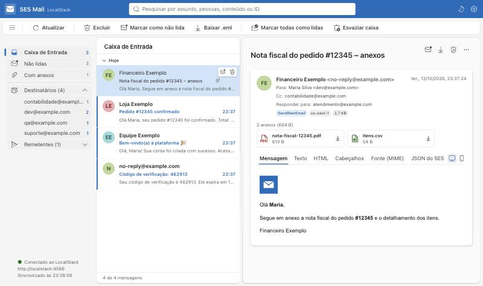
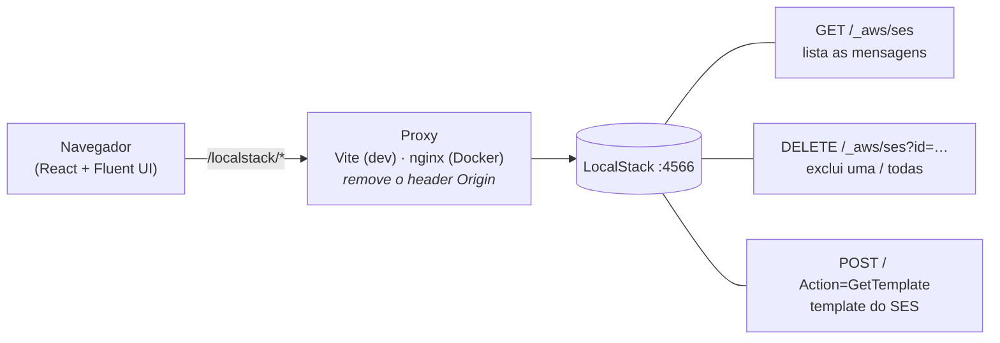

<div align="center">


# SES Mail Viewer

**Uma caixa de entrada estilo Outlook para os e-mails que a sua aplicação envia ao Amazon SES no [LocalStack](https://localstack.cloud).**

Veja cada mensagem do jeito que seus usuários veriam: HTML renderizado, anexos, imagens inline, templates e MIME bruto. Nenhum e-mail de verdade sai da sua máquina.

[](https://github.com/renatoasterio/ses-mail-viewer/actions/workflows/ci.yml)
[](LICENSE)


[Começando](#-começando) · [Funcionalidades](#-funcionalidades) · [Configuração](#%EF%B8%8F-configuração) · [Como funciona](#-como-funciona) · [English](README.md)

<br />



</div>

---

## ✨ Por quê

O LocalStack emula o SES mas não entrega e-mails: ele guarda tudo e expõe no endpoint interno `GET /_aws/ses`, em JSON, com o MIME bruto e anexos em base64. Ler isso na mão é sofrido.

O **SES Mail Viewer** transforma esse endpoint num cliente de e-mail de verdade, para você:

- conferir se os e-mails transacionais (cadastro, recuperação de senha, recibos…) estão certos **antes** de irem para produção;
- depurar templates, cabeçalhos, destinatários e anexos em segundos;
- dar ao time de QA e de design uma caixa de entrada amigável no lugar de um JSON.

É um app web estático, sem backend próprio, e funciona com **`SendEmail`, `SendTemplatedEmail` e `SendRawEmail`**.

## 🚀 Começando

> **Pré-requisito:** LocalStack rodando com SES (por padrão em `http://localhost:4566`).

### Opção A: Node (20.19+)

```bash
git clone https://github.com/renatoasterio/ses-mail-viewer.git
cd ses-mail-viewer
npm install
npm run dev
```

Abra **<http://localhost:8025>**.

### Opção B: Docker

```bash
docker build -t ses-mail-viewer .
docker run --rm -p 8025:8025 \
  -e LOCALSTACK_ENDPOINT=http://host.docker.internal:4566 \
  ses-mail-viewer
```

### Opção C: Docker Compose, junto com o LocalStack

```bash
export LOCALSTACK_AUTH_TOKEN=...   # exigido pelas imagens recentes do localstack/localstack
docker compose -f docker-compose.example.yml up --build
```

Para adicionar a um projeto que já tem LocalStack:

```yaml
services:
  ses-mail-viewer:
    build: ../caminho/para/ses-mail-viewer
    ports:
      - "8025:8025"
    environment:
      - LOCALSTACK_ENDPOINT=http://localstack:4566   # nome do serviço do LocalStack
```

O container pode subir antes do LocalStack. Enquanto ele não responde, a interface mostra "LocalStack indisponível" e reconecta sozinha.

### E-mails de exemplo

Com o **AWS CLI v2** instalado:

```bash
npm run seed
```

| API | O que testa |
| --- | --- |
| `SendEmail` | HTML + texto, nomes de exibição, Cc |
| `SendEmail` | Só texto |
| `SendTemplatedEmail` | Cria o template `pedido-confirmado` e renderiza com dados |
| `SendRawEmail` | MIME multipart, imagem inline `cid:`, anexos PDF e CSV, assunto codificado |

## 🧩 Funcionalidades

- 📬 **Layout de três painéis** no estilo Outlook, feito com [Fluent UI v9](https://react.fluentui.dev/), com tema claro e escuro.
- 🗂️ **Pastas**: Caixa de Entrada, Não lidas e Com anexos, além de filtro por **destinatário** e por **remetente**.
- 🔎 **Busca** por assunto, nomes, endereços, corpo, nome de anexo e ID da mensagem.
- 🔄 **Atualização automática** a cada 5 s (configurável), com aviso de e-mail novo e contador de não lidas no título da aba.
- 🛡️ **HTML num iframe isolado** com CSP restritiva: scripts não rodam e links abrem em outra aba.
- 📱 **Prévia desktop e mobile (375 px)** para templates responsivos.
- 🔬 **Inspeção**: texto puro, código HTML, cabeçalhos MIME decodificados, fonte MIME e JSON original do SES.
- 📎 **Anexos**: baixe ou abra PDF, imagem e texto numa nova aba. Imagens `cid:` aparecem no corpo.
- 🧾 **Templates** buscados no LocalStack (`GetTemplate`) e renderizados com Handlebars a partir do `TemplateData`.
- 💾 **Baixar `.eml`** para abrir no Outlook, Apple Mail ou Thunderbird.
- 🧹 **Excluir** uma mensagem ou **esvaziar a caixa** direto no LocalStack.

### Atalhos de teclado

| Tecla | Ação |
| --- | --- |
| <kbd>↑</kbd> / <kbd>↓</kbd> ou <kbd>K</kbd> / <kbd>J</kbd> | Mensagem anterior / próxima |
| <kbd>Delete</kbd> | Excluir mensagem |
| <kbd>U</kbd> | Alternar lida / não lida |
| <kbd>R</kbd> | Atualizar agora |
| <kbd>/</kbd> | Pesquisar |
| <kbd>Esc</kbd> | Limpar pesquisa |

## ⚙️ Configuração

| Variável | Padrão | Descrição |
| --- | --- | --- |
| `LOCALSTACK_ENDPOINT` | `http://localhost:4566` (dev)<br/>`http://localstack:4566` (Docker) | Endereço do LocalStack visto **pelo proxy**, não pelo navegador. |
| `PORT` | `8025` | Porta do visualizador. |
| `AWS_REGION` | `us-east-1` | Região usada pelo `npm run seed`. |
| `SEED_FROM` / `SEED_TO` | `no-reply@example.com` / `dev@example.com` | Remetente e destinatário do seed. |

Em desenvolvimento, copie o [`.env.example`](.env.example) para `.env`. Tema, intervalo de atualização e estado de lida ficam no `localStorage` de cada navegador.

## 🏗️ Como funciona



- O LocalStack responde **403 a chamadas de outra origem** (CORS), então tudo passa pelo proxy `/localstack`, que remove o `Origin`: Vite em dev ([`vite.config.ts`](vite.config.ts)) e nginx no Docker ([`docker/default.conf.template`](docker/default.conf.template)).
- Cada tipo de envio é convertido para um modelo único em [`src/lib/parse.ts`](src/lib/parse.ts).

Detalhes em [docs/ARCHITECTURE.md](docs/ARCHITECTURE.md) (em inglês).

## ⚠️ Limitações

- **Templates** são renderizados com a versão **atual**. Se o template mudou ou foi apagado depois do envio, o resultado muda (ou aparece um aviso).
- **Cco em `SendRawEmail`**: o LocalStack não guarda os `Destinations` do envio raw; só aparecem os destinatários dos cabeçalhos MIME.
- **Sem paginação**: cada atualização baixa todas as mensagens com anexos. Com muitas mensagens grandes, aumente o intervalo ou esvazie a caixa.
- **Lida/não lida** fica no `localStorage` de cada navegador.

Problemas? Veja [docs/TROUBLESHOOTING.md](docs/TROUBLESHOOTING.md).

## 🤝 Contribuindo

Contribuições são muito bem-vindas. Leia o [guia de contribuição](CONTRIBUTING.md) e o [código de conduta](CODE_OF_CONDUCT.md). Issues e PRs podem ser em português ou inglês.

## 📄 Licença

[MIT](LICENSE) © Renato Asterio
