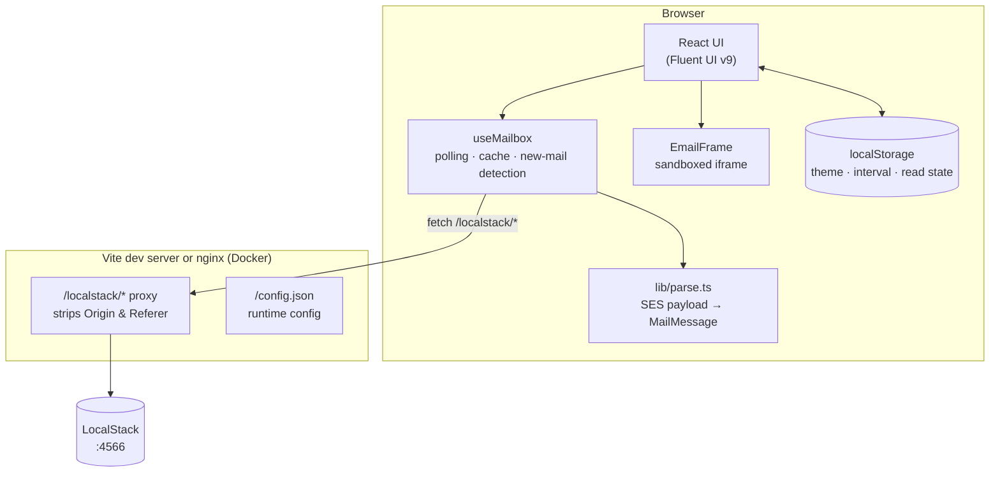

# Architecture

SES Mail Viewer is a **static React app** plus a **thin reverse proxy**. It has no database and no server code of its own: LocalStack is the single source of truth.

## Request flow

| Browser call | Forwarded to LocalStack | Purpose |
| --- | --- | --- |
| `GET /localstack/_aws/ses` | `GET /_aws/ses` | List every stored message (with raw MIME and attachments). |
| `DELETE /localstack/_aws/ses?id=<id>` | `DELETE /_aws/ses?id=<id>` | Delete one message. |
| `DELETE /localstack/_aws/ses` | `DELETE /_aws/ses` | Empty the inbox. |
| `POST /localstack/` (`Action=GetTemplate`) | SES Query API | Fetch the template used by a `SendTemplatedEmail`. |
| `GET /config.json` | none, answered by the server | Exposes `LOCALSTACK_ENDPOINT` so the UI can display it. |

### Why a proxy?

LocalStack answers `403` to browser requests whose `Origin` isn't in its CORS allow‑list. Rather than asking users to reconfigure LocalStack, both servers forward `/localstack/*` and drop the `Origin` and `Referer` headers:

- **Dev:** [`vite.config.ts`](../vite.config.ts) (`server.proxy` and `preview.proxy`).
- **Docker:** [`docker/default.conf.template`](../docker/default.conf.template), rendered by nginx's `envsubst` at container start.

The nginx config resolves the LocalStack hostname **per request** (`resolver` + a variable in `proxy_pass`). That's why the viewer container can start before LocalStack exists, and keeps working if LocalStack restarts with a new IP.

### Calling `GetTemplate` without credentials

LocalStack doesn't validate SigV4 signatures, but it reads the `Authorization` header to find the **region and account**. [`src/api/localstack.ts`](../src/api/localstack.ts) sends a syntactically valid header with a dummy signature and the message's region, so templates resolve in the right region.

## Message normalization

LocalStack stores each send API differently. [`parseMessage`](../src/lib/parse.ts) dispatches on the payload shape and produces one `MailMessage` ([`src/lib/model.ts`](../src/lib/model.ts)):

| Payload has… | Kind | How it's parsed |
| --- | --- | --- |
| `RawData` | `raw` | Base64 → MIME → [postal‑mime](https://github.com/postalsys/postal-mime). Headers, addresses, parts and attachments come from the MIME. `cid:` images are inlined as `data:` URIs. |
| `Template` | `template` | `GetTemplate` from LocalStack, then the subject/HTML/text parts are rendered with Handlebars using `TemplateData`. On failure, the message still shows, with an error banner and the raw data. |
| `Body` / `Subject` | `simple` | Read directly; recipients come from `Destination`. |

Every message is parsed **once** and cached by `Id` in `useMailbox`, so polling stays cheap even with heavy MIME. Each message also gets a normalized `searchText` for instant client‑side search.

## Polling

- Default interval: 5 s, configurable in the UI (or disabled).
- When the tab is hidden the effective interval is at least 30 s; returning to the tab syncs immediately.
- Concurrent refreshes are de‑duplicated (`inFlight`).
- New IDs compared to the previous sync trigger the "new mail" notification.

## Rendering untrusted HTML

Email bodies are untrusted input. [`EmailFrame`](../src/components/EmailFrame.tsx) renders them via `srcdoc` in an iframe with:

- `sandbox="allow-same-origin allow-popups allow-popups-to-escape-sandbox"`, which notably **excludes `allow-scripts`**;
- an injected CSP: `script-src 'none'; object-src 'none'; frame-src 'none'`;
- `<base target="_blank">` so links open in a new tab;
- zero‑specificity default styles (`:where(...)`) so the email's own CSS always wins.

`allow-same-origin` (without scripts) lets the parent measure the content height and size the frame to fit.

## Docker image

A multi‑stage build: `node:20-alpine` builds the bundle, then `nginx:1.27-alpine` serves `dist/` and the proxy. Configuration is read **at container start**, so one image works in any environment:

| Env | Default |
| --- | --- |
| `LOCALSTACK_ENDPOINT` | `http://localstack:4566` |
| `PORT` | `8025` |
